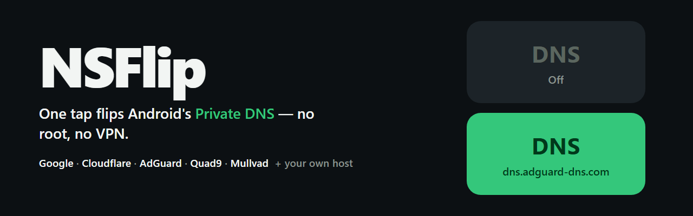

<div align="center">
  
  <p><em>One tap flips Android's Private DNS — no root, no VPN.</em></p>
  <p>
    <a href="https://github.com/anik-amd/nsflip/actions/workflows/build.yml"></a>
    
    
  </p>
  <!-- Screenshots: coming after UI polish pass -->
</div>

# NSFlip

NSFlip makes Android's **Private DNS** one tap away. Private DNS is Android's
built-in encrypted-DNS resolver — set it to an ad-blocking provider and ads and
trackers die at the network layer for every app, browser, and background
process. The setting is buried under *Settings → Network → Private DNS*; NSFlip
puts it in a home app and a **Quick Settings tile**.

What it is not: a VPN service, a root app, or a background process. NSFlip
opens, writes one system setting, closes. **Battery cost: zero.**

## Features

| | |
| --- | --- |
| **Quick Settings tile** | Tap to toggle last-used host. Active tile shows the host as its subtitle. Long-press opens the app. |
| **Curated providers** | Google, Cloudflare (default / security / family), AdGuard (default / family), Quad9, Mullvad (default / ad-block). Tap to connect. |
| **Custom hosts** | Add any DoT hostname with live validation — hostnames only, never raw IPs. |
| **One-time setup** | Grants `WRITE_SECURE_SETTINGS` once via Shizuku or adb. Never asked again. |
| **Honest offline state** | Tile shows *Not set up* until the grant exists; no crashes, no gray screens. |

## Providers included

| Provider | Hostname | Blocks |
| --- | --- | --- |
| Google | `dns.google` | — (resolver only) |
| Cloudflare | `one.one.one.one` | — |
| Cloudflare Security | `security.cloudflare-dns.com` | malware |
| Cloudflare Family | `family.cloudflare-dns.com` | malware + adult |
| AdGuard | `dns.adguard-dns.com` | ads + trackers |
| AdGuard Family | `dns-family.adguard-dns.com` | ads + malware + adult |
| Quad9 | `dns.quad9.net` | malware |
| Quad9 (no DNSSEC) | `dns11.quad9.net` | malware, faster |
| Mullvad | `dns.mullvad.net` | — |
| Mullvad Ad-Block | `adblock.dns.mullvad.net` | ads + trackers |

Hostnames are DoT (DNS-over-TLS) only — that's what Android's Private DNS
supports. Verify against [provider docs](https://adguard.com/kb/dns/public-dns/)
when adding yours.

## Install

1. Download the latest APK from
   [Releases](https://github.com/anik-amd/nsflip/releases) and install it
   (allow "install unknown apps" — it's a side-loaded APK).
2. Open NSFlip once → setup screen appears.
3. Grant the one-time permission, either way:

   **Shizuku (recommended, no PC):**
   - Install [Shizuku](https://shizuku.rikka.app/) and start it once from your
     device or with wireless debugging.
   - In NSFlip: *Allow Shizuku access* → *Grant one-tap*. Done.

   **Plain adb (no Shizuku):**
   ```sh
   adb shell pm grant io.nsflip.app android.permission.WRITE_SECURE_SETTINGS
   ```
   Connect USB once, run the command, reopen NSFlip.

4. Add the **DNS** tile to your Quick Settings, tap it, done.

A full reinstall resets the grant (Android policy) — setup reappears, two taps.

## Build

Needs JDK 17 + Android SDK (platform 35). Two supported paths, both remote:

- **GitHub Actions** — every push builds the debug APK and runs unit tests;
  the APK lands on the run page as an artifact.
- **GitHub Codespaces** — repo ships a devcontainer with the Android SDK
  preinstalled. Create a Codespace and run:

  ```sh
  gradle :app:assembleDebug :app:testDebugUnitTest
  ```

## Testing

Unit tests cover hostname validation (`DnsEntryTest`) and check every curated
provider hostname. Behavior needs a **real device** — emulator Private DNS is
flaky. Test matrix used for 0.0.1: one real device, manual.

## Privacy

NSFlip makes no network connections. No analytics, no crash reporting, no
account settings, no data collection whatsoever. Source is fully open.

## License

GPLv3 or later. See [LICENSE](LICENSE). Source-file headers note the license
via SPDX (`SPDX-License-Identifier: GPL-3.0-or-later`). Third-party note: the
Shizuku API library is Apache-2.0, compatible with GPLv3 linking.
